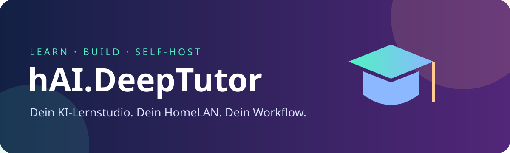
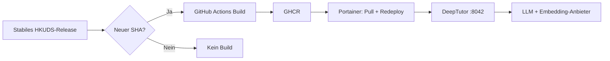

<div align="center">


# 🦈 hAI.DeepTutor

### Dein KI-Lernstudio. Dein HomeLAN. Dein Workflow.

[](https://github.com/jbkunama1/hAI.DeepTutor/actions/workflows/build.yml)
[](https://github.com/jbkunama1/hAI.DeepTutor/pkgs/container/hai.deeptutor)


[](https://github.com/jbkunama1/hAI.DeepTutor/commits/main)

[🚀 Schnellstart](#-schnellstart-mit-portainer) · [⚙️ Konfiguration](#️-konfiguration) · [🔄 Updates](#-automatische-release-prüfung) · [🌐 Pages](#-github-pages)
</div>

## ✨ Was steckt drin?

| Baustein | Aufgabe |
| --- | --- |
| 📚 DeepTutor | Dokumentgestütztes KI-Lernen mit konfigurierbaren Modellanbietern |
| 🏗️ GitHub Actions | Eigener Quellcode-Build aus stabilem HKUDS-Release |
| 📦 GHCR | latest und eindeutige Build-Tags |
| 🐳 Portainer | Deployment ohne Build auf dem HomeLAN-Host |
| 🔄 Release-Radar | Täglicher SHA-Vergleich; Build nur bei geändertem Stand |
| 🎨 Projektseite | Responsive GitHub-Pages-Startseite mit eigener SVG-Grafik |



## 🚀 Schnellstart mit Portainer

1. Erfolgreichen [Build](https://github.com/jbkunama1/hAI.DeepTutor/actions/workflows/build.yml) abwarten.
2. GHCR-Package für anonymes Pulling auf Public setzen oder Portainer eine GHCR-Registry mit read:packages-Token geben. Öffentliches Repo garantiert kein öffentliches Package.
3. Externes Docker-Netzwerk highfishNetwork auf dem Zielhost sicherstellen; falls nötig in Portainer als Bridge-Netzwerk anlegen.
4. Stacks → Add stack → Repository verwenden:

| Feld | Wert |
| --- | --- |
| Repository | https://github.com/jbkunama1/hAI.DeepTutor |
| Referenz | refs/heads/main |
| Compose-Pfad | docker-compose.yaml |
| Netzwerk | highfishNetwork (extern) |
| Port-Mapping | 8042:3782 |
| Datenvolume | hai-deeptutor-data |

5. Deployen und http://SERVER-IP:8042 öffnen.
6. LLM, Embeddings und API-Schlüssel in den Web-Einstellungen konfigurieren.

```text
ghcr.io/jbkunama1/hai.deeptutor:latest
```

## ⚙️ Konfiguration

Keine Pflicht-ENVs in Portainer. Alle Werte haben Vorgaben:

| Variable | Standard | Bedeutung |
| --- | --- | --- |
| IMAGE_TAG | latest | Alternativ eindeutigen Build-Tag einsetzen |
| WEB_PORT | 8042 | Veröffentlichter Host-Port |
| BIND_IP | 0.0.0.0 | Alle Host-Interfaces; alternativ gezielt LAN-IP |

TZ=Europe/Berlin ist gesetzt. Das Netzwerk ist fest highfishNetwork. .env.example ist optional. Modell-API-Schlüssel nicht ins Repository schreiben. Laufzeiteinstellungen liegen unter /app/data/user/settings/ im Volume; der Container lädt diese aus JSON. Keine zusätzlichen LLM_API_KEY-/AUTH_*-ENVs für diesen Stack erforderlich. Backend-Port 8001 bleibt unveröffentlicht.

Für Ollama auf demselben Docker-Host ist host.docker.internal vorbereitet, zum Beispiel http://host.docker.internal:11434/v1 als OpenAI-kompatible LLM-URL. Embeddings passend zum gewählten Anbieter separat konfigurieren. localhost bezeichnet im Container nicht den Docker-Host.

## 🔄 Automatische Release-Prüfung

- Zeitplan: täglich 03:23 UTC (04:23 MEZ / 05:23 MESZ). Geplanter Tagesrhythmus, keine garantierte sekundengenaue 24h-Ausführung; GitHub kann Läufe verzögern. Bei längerer Inaktivität öffentlicher Repositories können geplante Workflows deaktiviert werden.
- Quelle: neuestes stabiles Release von HKUDS/DeepTutor, keine Vorabversionen und keine unreleasten main-Commits.
- Vergleich: exakter Upstream-Commit-SHA gegen .github/upstream-built.json aus dem letzten erfolgreichen Build.
- Ohne Änderung: kein Docker-Build und kein GHCR-Push.
- Bei Änderung: Upstream am SHA auschecken, Dockerfile target production bauen und GHCR veröffentlichen.
- Erst nach erfolgreichem Push wird der Stand als verarbeitet im Repo gespeichert. Bei Fehlern ist beim nächsten Check erneut ein Build fällig.
- Manueller Lauf über Actions → Build and publish DeepTutor → Run workflow erzwingt einen Build. Auch Workflow-/upstream.env-Commits erzwingen einen Build.
- upstream.env ist nicht länger eine Versionssperre: die Auswahl erfolgt automatisch über das neueste stabile Release.
- Tags: latest und upstream-<SHA>-run-<RUN_ID>-<ATTEMPT>. Letztere für gezielte Deployments/Rollbacks verwenden.
- Kein automatischer Portainer-Redeploy! Laufende Container bleiben unverändert, bis du neu pullst und bereitstellst.

Der Workflow benötigt contents:write für den Erfolgsstand und packages:write für GHCR, beides über GITHUB_TOKEN. Branch-Regeln können den Status-Commit blockieren; dann erscheint der Lauf als fehlgeschlagen und der nächste Check baut erneut. Unterstützt wird derzeit linux/amd64. Basisimages und Abhängigkeiten sind nicht vollständig digest-fixiert; kein vollständig reproduzierbarer Build. Automatische neue Releases können inkompatible Änderungen enthalten: vor dem Redeploy sichern und Release-Hinweise lesen.

## 🌐 GitHub Pages

Die Projektseite liegt in docs/index.html, die Grafik in docs/assets/banner.svg. In Settings → Pages → Build and deployment: Deploy from a branch, main, /docs wählen. Das ist ein separater Einrichtungsschritt; dieser Commit aktiviert Pages nicht automatisch.

Nach Aktivierung vorgesehene Adresse: https://jbkunama1.github.io/hAI.DeepTutor/

Die Seite ist reine Dokumentation, kein öffentlich gehostetes DeepTutor-Backend.

## 🔐 Sicherheit

Nur im vertrauenswürdigen LAN betreiben, keine Router-Portfreigabe. BIND_IP=0.0.0.0 bindet an alle Host-Interfaces. Vor weiteren Benutzern/externer Erreichbarkeit Authentifizierung gemäß Upstream einrichten und nötigenfalls neu starten. Keine Docker-Socket-Mounts, keinen privileged-Modus und keine persönlichen Hostverzeichnisse einbinden. Der einfache Stack hat keinen separaten gehärteten Code-Runner und ist keine zugesicherte sichere Sandbox für fremde Benutzer. Ein gemeinsames highfishNetwork isoliert Container nicht voneinander. Externe LLM-/Embedding-APIs können Dokumentinhalte aus dem LAN übertragen.

## 💾 Backup, Updates & Rollback

Stack für konsistentes Backup stoppen. Auf dem Docker-Host:

```bash
mkdir -p backups
chmod 700 backups
docker run --rm -v hai-deeptutor-data:/data:ro -v "$PWD/backups:/backup" alpine:3.20 tar czf /backup/deeptutor-data.tar.gz -C /data .
```

Danach Stack starten. Backup enthält eventuell API-Schlüssel und personenbezogene Daten: geschützt lagern, nie committen. Wiederherstellung bei gestoppter App in ein leeres Zielvolume mit getesteter Sicherung. Nur eine Instanz gleichzeitig mit diesem Volume betreiben.

Nach erfolgreichem Build in Portainer Image neu pullen und Stack erneut bereitstellen. Rollback über vorherigen eindeutigen Build-Tag; bei inkompatiblen Datenänderungen passende Datensicherung zurückspielen.

## 🩺 Troubleshooting

| Problem | Prüfen |
| --- | --- |
| Image nicht verfügbar | Erfolgreicher Build? Package öffentlich oder Registry-Login vorhanden? |
| Netzwerk fehlt | highfishNetwork auf dem Zielhost anlegen |
| Port belegt | WEB_PORT ändern |
| Modell nicht erreichbar | Anbieter-URL, Netzwerk und Modellserver-Bind-Adresse prüfen |
| Container unhealthy | Logs und Health-Status in Portainer ansehen |
| Täglicher Check fehlt | Actions aktiviert? Schedule deaktiviert oder verzögert? |

Healthcheck kommt aus dem Upstream-Image. restart: unless-stopped startet einen nur ungesunden Container nicht automatisch neu. Verbrauch mit docker stats messen und zunächst wenige Dokumente importieren. Konfiguration im Repo ist kein Beleg für erfolgreichen Build, GHCR-Publish oder getesteten Laufzeitbetrieb.

## 🤝 Upstream & Lizenz

Dieses Repository verwaltet Deployment und Dokumentation, nicht die Urheberschaft am DeepTutor-Code. Lizenz und Hinweise von [HKUDS/DeepTutor](https://github.com/HKUDS/DeepTutor) gelten für dessen Code. [Offizielle Docker-Dokumentation](https://docs.deeptutor.info/get-started/docker/).
